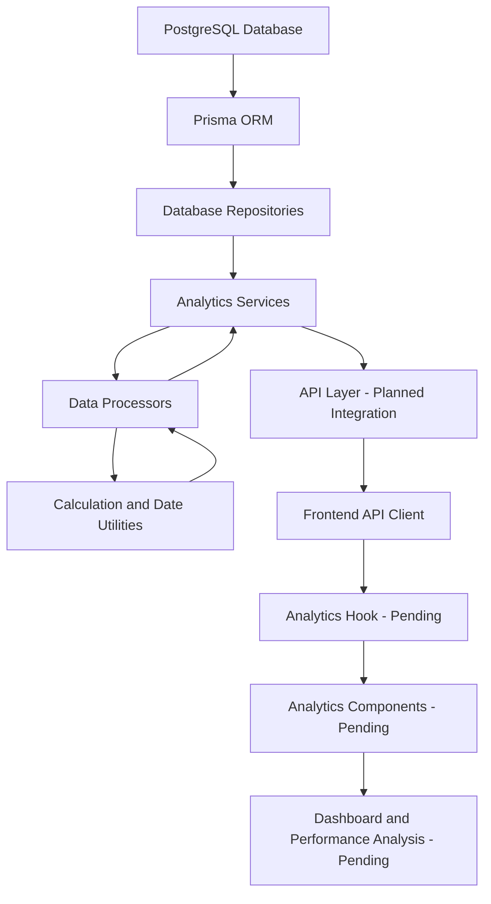

# Analytics Architecture

## 1. Architecture Overview

The analytics module of the Movie Performance Management System follows a layered architecture that separates database access, business calculations, data processing, service coordination and frontend presentation.

The architecture is designed to support a single cinema hall while maintaining separation between the responsibilities assigned to individual team members.

The module uses the existing PostgreSQL database and repository functions rather than introducing a separate data storage system.

## 2. System Architecture



The database, repository layer, backend analytics services, processors and calculation utilities have been implemented and independently tested.

The integration between the analytics services, API layer and frontend analytics components remains pending.

## 3. Backend Directory Structure

```text
backend/src/avishek/
├── processors/
│   ├── chartData.processor.ts
│   ├── revenue.processor.ts
│   └── weeklyData.processor.ts
├── services/
│   ├── analytics.service.ts
│   ├── comparison.service.ts
│   ├── revenue.service.ts
│   ├── reviewFlags.service.ts
│   └── trend.service.ts
├── types/
│   └── analytics.types.ts
├── utils/
│   ├── calculations.ts
│   └── dateUtils.ts
└── tests/
    ├── utilities.test.ts
    ├── processors.test.ts
    ├── liveAnalytics.test.ts
    └── services.test.ts
```

## 4. Architecture Layers

### 4.1 Database Layer

PostgreSQL provides persistent storage for movie information, weekly performance records and system settings.

The analytics module primarily retrieves information from the movies and performance tables through the existing repository functions.

Database constraints and relationships are managed by the database module.

### 4.2 Repository Layer

The repository layer provides reusable database operations through Prisma ORM.

The analytics module uses existing repository functions, including:

| Repository Function | Purpose |
|---|---|
| listMovies | Retrieve movie information and current screening status |
| weeklyReport | Retrieve weekly movie performance |
| listWeeks | Retrieve available reporting weeks |
| revenueTrend | Retrieve historical revenue records |
| reviewFlags | Retrieve movies that meet management review conditions |

The analytics module does not duplicate these database queries. This maintains consistency between reporting, data entry and analytics operations.

### 4.3 Utility Layer

The utility layer contains reusable functions for numerical calculations and reporting date validation.

The calculations.ts file provides currency rounding, percentage calculations, revenue differences, revenue shares and numerical aggregation.

The dateUtils.ts file provides date validation, Monday-based reporting week validation, previous and subsequent week calculations and reporting range validation.

These functions operate independently of the database and can be tested separately.

### 4.4 Data Processing Layer

The processing layer transforms repository results into structured analytics information.

| Processor | Responsibility |
|---|---|
| revenue.processor.ts | Revenue summaries and individual movie comparisons |
| weeklyData.processor.ts | Weekly analytics, screening summaries and performance totals |
| chartData.processor.ts | Revenue chart data and historical revenue trends |

Processors receive data as function arguments and return structured results without directly accessing the database.

This separation allows calculation and transformation behaviour to be independently tested.

### 4.5 Analytics Service Layer

The service layer coordinates database retrieval, input validation and data processing.

| Service | Responsibility |
|---|---|
| revenue.service.ts | Retrieve and calculate weekly revenue summaries |
| comparison.service.ts | Compare individual movie performance |
| trend.service.ts | Retrieve cinema-wide and individual movie revenue trends |
| reviewFlags.service.ts | Validate review thresholds and retrieve management review flags |
| analytics.service.ts | Coordinate weekly analytics and consolidated dashboard results |

The services retrieve current database records whenever analytics are requested. This ensures that newly entered or corrected performance records are included in subsequent calculations.

### 4.6 Data Type Layer

The analytics.types.ts file defines TypeScript interfaces for structured analytics results.

These interfaces include revenue summaries, screening summaries, weekly analytics, revenue trends, movie comparisons, review thresholds and consolidated dashboard data.

The type definitions maintain consistency between processors and services and reduce errors caused by incompatible data structures.

## 5. Backend Service Interfaces

| Function | Purpose |
|---|---|
| getRevenueSummary | Calculate revenue statistics for a selected reporting week |
| getMovieComparison | Return individual movie performance comparisons |
| getRevenueTrend | Return aggregated cinema revenue across a reporting range |
| getMovieRevenueTrends | Return historical revenue grouped by movie |
| getReviewFlags | Identify movies requiring management review |
| getWeeklyAnalytics | Return consolidated weekly performance information |
| getDashboardAnalytics | Return weekly analytics, charts, comparisons and review flags |

These functions have been implemented and independently tested against the database.

The consolidated dashboard service is an internal backend interface. Its availability as a dedicated HTTP endpoint has not been established and will depend on the agreed API integration.

## 6. Data Flow

### 6.1 Weekly Analytics

1. A reporting week is provided to the analytics service.
2. The reporting date is validated to ensure that it represents a Monday.
3. The corresponding previous reporting week is calculated.
4. Current and previous weekly performance records are retrieved through the repository layer.
5. Current movie screening information is retrieved.
6. The processors calculate revenue summaries, performance totals and movie comparisons.
7. Structured analytics results are returned to the calling module.

### 6.2 Historical Revenue Trends

1. A start week and end week are provided.
2. Both reporting dates and their chronological order are validated.
3. Historical performance records are retrieved from the database.
4. Revenue records are grouped by reporting week or individual movie.
5. The results are ordered chronologically.
6. Structured trend data is returned for visualisation.

### 6.3 Management Review

1. A reporting week and review thresholds are provided.
2. The reporting date and threshold values are validated.
3. The existing review flag repository function evaluates movie performance.
4. Movies meeting the review conditions are returned with their corresponding reasons.
5. Management can use the results to support screening decisions.

The analytics module does not automatically modify movie screening status.

## 7. Data Consistency

The consolidated dashboard service uses a database transaction with Repeatable Read isolation.

This allows the weekly analytics, historical revenue and management review queries within a dashboard request to operate against a consistent database snapshot.

Revenue calculations are performed using numerical utilities that maintain currency precision. Revenue aggregation converts individual amounts into cents before calculating totals.

Missing performance records are distinguished from recorded zero revenue. Missing previous-week revenue does not produce an artificial percentage change.

Current screening status is retrieved from the movie records. It represents the present screening status rather than a historical reconstruction of screening status for a selected week.

## 8. Manual Data Entry Integration

The analytics module is designed to process records entered through the movie input and weekly revenue management functions.

The backend does not depend on fixed movie identifiers, hardcoded revenue values or a fixed number of reporting weeks.

When a new movie or performance record is created, the information becomes available to subsequent analytics requests.

When an existing performance record is corrected or deleted, subsequent calculations reflect the updated database state.

This behaviour has been verified through database integration tests.

Automatic frontend refresh following successful data entry remains an integration requirement.

## 9. Frontend Architecture

The frontend analytics module is organised as follows:

```text
frontend/src/avishek/
├── components/
│   ├── MovieComparison.tsx
│   ├── PerformanceCards.tsx
│   ├── RevenueBarChart.tsx
│   ├── RevenueTrendChart.tsx
│   └── ReviewFlags.tsx
├── hooks/
│   └── useAnalytics.ts
├── pages/
│   ├── AnalyticsDashboard.tsx
│   └── PerformanceAnalysis.tsx
├── types/
│   └── analytics.types.ts
└── utils/
    ├── chartData.ts
    └── revenueCalculations.ts
```

The frontend analytics types and utility functions have been implemented.

The remaining components, pages and analytics hook are pending development.

The planned frontend architecture separates API communication from visual presentation. The analytics hook will coordinate data retrieval and application state, while individual components will receive structured analytics information for display.

Recharts has been installed to support responsive revenue charts and historical performance visualisation.

## 10. API Integration

The frontend application contains a shared API client that uses the /api/v1 base path.

During local development, Vite forwards API requests to the backend server configured on port 5000.

The analytics module will reuse the shared API client rather than introduce a separate HTTP communication mechanism.

The agreed API contract includes endpoints for weekly reports, available reporting weeks, revenue trends and management review flags.

The existing shared weekly report normalisation function retains only basic movie revenue fields. Analytics-specific response mapping will therefore be required to preserve additional performance information.

The final response mapping and endpoint compatibility will be verified when the API implementation becomes available.

## 11. Error Handling

The backend analytics utilities and services validate reporting dates, reporting ranges, movie identifiers and review thresholds.

Invalid input is rejected before the relevant analytics operation proceeds.

The shared frontend API client provides mechanisms for handling network errors and unsuccessful HTTP responses.

The planned analytics frontend will distinguish between loading states, unavailable data, successful responses and API errors.

End-to-end error handling has not yet been validated because live API integration remains pending.

## 12. Architecture Limitations

The current architecture is designed for a single cinema hall and does not include multi-location analytics.

Historical screening status reconstruction is outside the current implementation.

The frontend analytics components and their integration with the shared application layout remain incomplete.

Live API compatibility, automatic frontend refresh and end-to-end system behaviour require further validation.

The existing frontend dependencies also have reported security advisories that require coordinated review before deployment.

## 13. Conclusion

The layered analytics architecture provides separation between database access, business calculations, data processing and presentation.

The backend architecture has been implemented and independently validated. Frontend infrastructure and supporting utilities are also available.

The remaining development will focus on connecting the analytics module to the completed API and presenting actual movie performance information through the frontend dashboard.