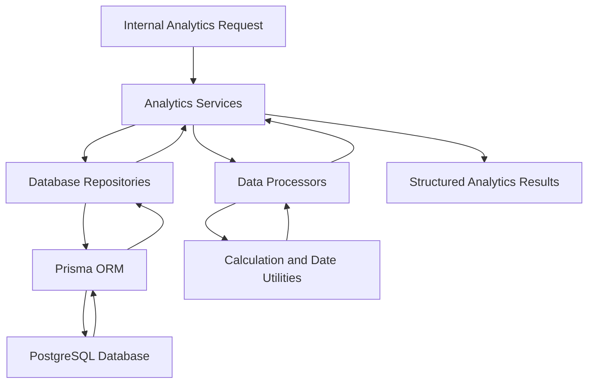
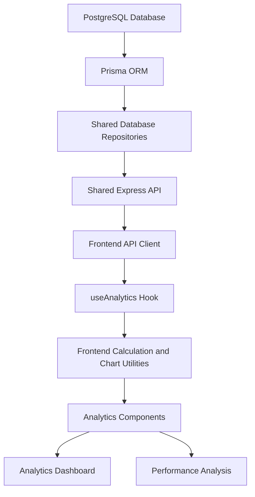
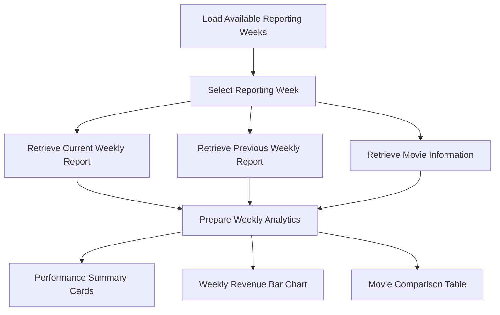
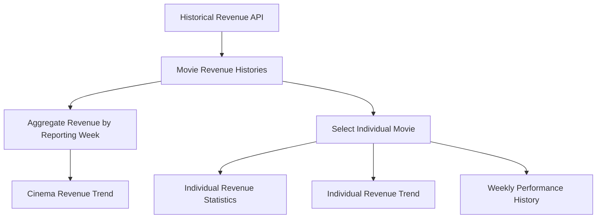
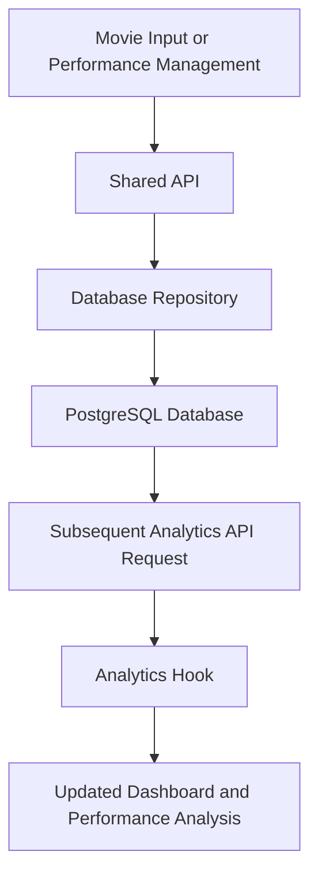
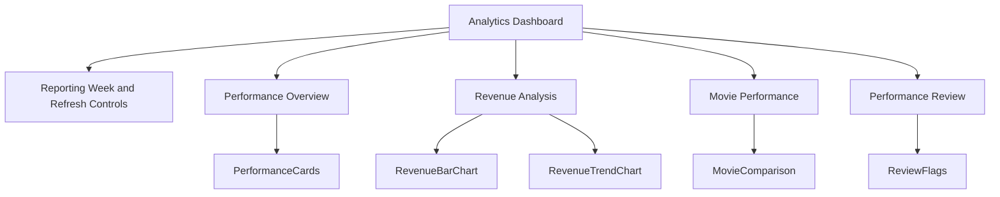
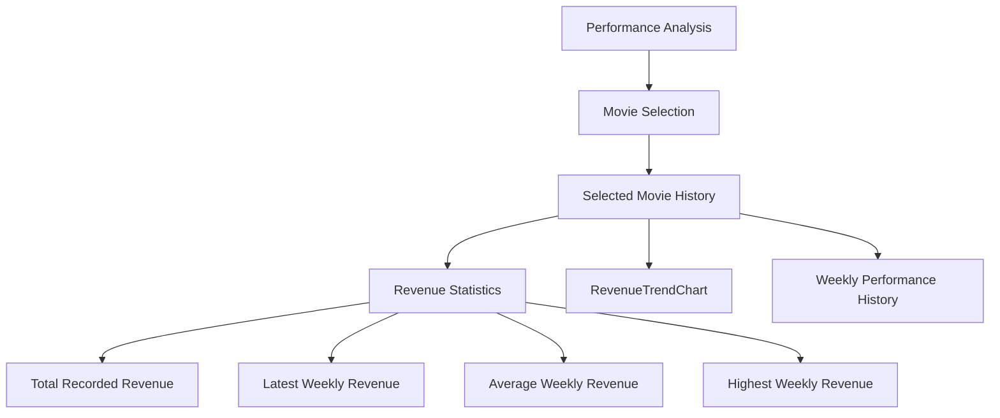

# Analytics Architecture

## 1. Architecture Overview

The analytics module of the Movie Performance Management System follows a layered architecture that separates database access, business calculations, data processing, service coordination and frontend presentation.

The architecture is designed to support a single cinema hall while maintaining separation between the responsibilities assigned to individual team members.

The module uses the existing PostgreSQL database and repository functions rather than introducing a separate data storage system.

The completed implementation includes backend analytics services, frontend visualisation components and integration with the shared API.

## 2. System Architecture

The system provides two related analytics processing paths: the internal backend analytics services and the integrated frontend analytics workflow.

### 2.1 Backend Analytics Architecture



The backend analytics services coordinate database retrieval, input validation, financial calculations and data transformation.

The consolidated analytics service provides an internal interface for retrieving consistent dashboard information through a database transaction.

### 2.2 Integrated Frontend Architecture



The frontend retrieves information through the implemented shared API endpoints.

The analytics hook combines weekly reports, movie information, historical revenue and management review results to prepare the information required by the frontend components.

The internal consolidated analytics service is implemented and tested but is not directly exposed through a dedicated dashboard HTTP endpoint in the current integration.

## 3. Backend Directory Structure

```text
backend/src/avishek/
|-- processors/
|   |-- chartData.processor.ts
|   |-- revenue.processor.ts
|   `-- weeklyData.processor.ts
|-- services/
|   |-- analytics.service.ts
|   |-- comparison.service.ts
|   |-- revenue.service.ts
|   |-- reviewFlags.service.ts
|   `-- trend.service.ts
|-- types/
|   `-- analytics.types.ts
|-- utils/
|   |-- calculations.ts
|   `-- dateUtils.ts
`-- tests/
    |-- utilities.test.ts
    |-- processors.test.ts
    |-- liveAnalytics.test.ts
    `-- services.test.ts
```

The backend directory structure separates calculation logic, data transformation, database-backed services, type definitions and testing.

## 4. Architecture Layers

### 4.1 Database Layer

PostgreSQL provides persistent storage for movie information, weekly performance records and system settings.

The analytics module primarily retrieves information from the movies and performance tables through the existing repository functions.

Database constraints and relationships are managed by the shared database module.

The database supports unique movie and reporting week combinations, decimal revenue values, optional operational counts and current screening statuses.

### 4.2 Repository Layer

The repository layer provides reusable database operations through Prisma ORM.

The analytics module uses existing repository functions, including:

| Repository Function | Purpose |
|---|---|
| listMovies | Retrieve movie information and current screening status |
| weeklyReport | Retrieve weekly movie performance |
| listWeeks | Retrieve available reporting weeks |
| revenueTrend | Retrieve historical revenue records |
| reviewFlags | Retrieve movies that meet management review conditions |

The analytics module reuses these database queries rather than implementing an independent repository layer.

This maintains consistency between reporting, data entry and analytics operations.

### 4.3 Utility Layer

The utility layer contains reusable functions for numerical calculations and reporting date validation.

The calculations.ts file provides currency rounding, percentage calculations, revenue differences, revenue shares and numerical aggregation.

The dateUtils.ts file provides date validation, Monday-based reporting week validation, previous and subsequent week calculations and reporting range validation.

These functions operate independently of the database and can be tested separately.

### 4.4 Data Processing Layer

The processing layer transforms repository results into structured analytics information.

| Processor | Responsibility |
|---|---|
| revenue.processor.ts | Revenue summaries and individual movie comparisons |
| weeklyData.processor.ts | Weekly analytics, screening summaries and performance totals |
| chartData.processor.ts | Revenue chart data and historical revenue trends |

Processors receive data as function arguments and return structured results without directly accessing the database.

This separation allows calculation and transformation behaviour to be independently tested.

### 4.5 Analytics Service Layer

The service layer coordinates database retrieval, input validation and data processing.

| Service | Responsibility |
|---|---|
| revenue.service.ts | Retrieve and calculate weekly revenue summaries |
| comparison.service.ts | Compare individual movie performance |
| trend.service.ts | Retrieve cinema-wide and individual movie revenue trends |
| reviewFlags.service.ts | Validate review thresholds and retrieve management review flags |
| analytics.service.ts | Coordinate weekly analytics and consolidated dashboard results |

The services retrieve current database records whenever analytics are requested.

This ensures that newly entered, corrected and deleted performance records are reflected in subsequent calculations.

### 4.6 Data Type Layer

The analytics.types.ts file defines TypeScript interfaces for structured analytics results.

These interfaces include revenue summaries, screening summaries, weekly analytics, revenue trends, movie comparisons, review thresholds and consolidated dashboard data.

The type definitions maintain consistency between processors and services and reduce errors caused by incompatible data structures.

The frontend maintains corresponding analytics types for processing and presenting API responses.

## 5. Backend Service Interfaces

| Function | Purpose |
|---|---|
| getRevenueSummary | Calculate revenue statistics for a selected reporting week |
| getMovieComparison | Return individual movie performance comparisons |
| getRevenueTrend | Return aggregated cinema revenue across a reporting range |
| getMovieRevenueTrends | Return historical revenue grouped by movie |
| getReviewFlags | Identify movies requiring management review |
| getWeeklyAnalytics | Return consolidated weekly performance information |
| getDashboardAnalytics | Return weekly analytics, charts, comparisons and review flags |

These functions have been implemented and independently tested against the database.

The consolidated dashboard service remains an internal backend interface.

The current shared API does not expose a dedicated endpoint returning the complete consolidated dashboard structure. The frontend therefore combines information from the available reporting and management endpoints.

The internal analytics services remain available for future API integration and reuse.

## 6. Data Flow

### 6.1 Backend Weekly Analytics

1. A reporting week is provided to the analytics service.
2. The reporting date is validated to ensure that it represents a Monday.
3. The corresponding previous reporting week is calculated.
4. Current and previous weekly performance records are retrieved through the repository layer.
5. Current movie screening information is retrieved.
6. The processors calculate revenue summaries, performance totals and movie comparisons.
7. Structured analytics results are returned to the calling module.

### 6.2 Frontend Weekly Analytics

The frontend uses the available shared API endpoints to prepare weekly analytics.



The frontend calculates the previous reporting week by subtracting seven days from the selected reporting date.

The current weekly report, previous weekly report and movie information are retrieved through concurrent API requests.

The analytics hook prepares revenue summaries, operational performance totals and current screening status counts.

### 6.3 Backend Historical Revenue Trends

1. A start week and end week are provided.
2. Both reporting dates and their chronological order are validated.
3. Historical performance records are retrieved from the database.
4. Revenue records are grouped by reporting week or individual movie.
5. The results are ordered chronologically.
6. Structured trend data is returned for visualisation.

### 6.4 Frontend Historical Revenue Trends

The shared revenue trend endpoint returns historical performance information grouped by movie.

The analytics hook aggregates individual movie revenue records by reporting week to prepare the cinema-wide historical revenue trend.

Individual movie histories are also retained for use by the Performance Analysis page.



Missing reporting weeks are represented as null values during chart preparation.

Recorded zero revenue remains a valid numerical value.

### 6.5 Management Review

1. A reporting week and review thresholds are provided.
2. The reporting date and threshold values are validated.
3. The existing review flag repository function evaluates movie performance.
4. Movies meeting the review conditions are returned with their corresponding reasons.
5. The shared management review API provides the results to the frontend.
6. The ReviewFlags component displays movies requiring management attention.
7. Management can use the results to support screening decisions.

The default minimum weekly revenue threshold is AUD 5,000.

The default significant revenue decline threshold is 30%.

Movies with ended screenings are excluded from management review.

The analytics module does not automatically modify movie screening status.

## 7. Data Consistency

### 7.1 Consolidated Backend Analytics

The consolidated dashboard service uses a database transaction with Repeatable Read isolation.

This allows the weekly analytics, historical revenue and management review queries within a consolidated service request to operate against a consistent database snapshot.

The transaction reduces the risk of inconsistent results when related records are modified during analytics processing.

### 7.2 Integrated Frontend Analytics

The frontend retrieves analytics information through multiple independent API requests.

Although these requests retrieve current database information, they do not share the same database transaction.

Consequently, simultaneous database modifications may temporarily produce differences between separately retrieved analytics sections.

The Refresh Data function allows users to retrieve updated information.

A dedicated consolidated dashboard endpoint could provide stronger consistency between frontend analytics sections in a future implementation.

### 7.3 Numerical Consistency

Revenue calculations are performed using numerical utilities that maintain currency precision.

Revenue aggregation converts individual amounts into cents before calculating totals.

Monetary values are rounded to two decimal places, while percentage changes and revenue shares are rounded to one decimal place.

### 7.4 Missing Data Consistency

Missing performance records are distinguished from recorded zero revenue.

Missing previous-week revenue does not produce an artificial percentage change.

When previous revenue is zero, percentage change is unavailable to prevent division by zero.

Missing historical reporting weeks are represented as gaps in revenue charts.

Unavailable operational counts are represented as null rather than incomplete aggregate totals.

### 7.5 Screening Status Consistency

Current screening status is retrieved from the movie records.

It represents the present screening status rather than a historical reconstruction of screening status for a selected week.

Historical revenue records remain available for movies with ended screenings.

## 8. Manual Data Entry Integration

The analytics module processes records entered through the movie input and weekly revenue management functions.

The backend does not depend on fixed movie identifiers, hardcoded revenue values or a fixed number of reporting weeks.

When a new movie or performance record is created, the information becomes available to subsequent analytics requests.

When an existing performance record is corrected or deleted, subsequent calculations reflect the updated database state.

### 8.1 Data Update Workflow



The integrated frontend provides a Refresh Data function that retrieves updated reporting weeks, weekly reports, historical revenue and management review information.

Continuous real-time synchronisation between separate user sessions is outside the current implementation.

### 8.2 Integration Verification

Manual data entry was verified through the integrated movie input workflow.

Automated database and API testing verified record insertion, correction and deletion.

Live analytics testing produced the following results:

| Operation | Weekly Revenue |
|---|---:|
| Original database state | AUD 159,550.00 |
| Temporary performance record insertion | AUD 169,550.00 |
| Temporary performance record correction | AUD 174,550.00 |
| Final restored database state | AUD 159,550.00 |

The tests confirmed that the analytics architecture responds to changes in actual database records.

## 9. Frontend Architecture

### 9.1 Frontend Directory Structure

```text
frontend/src/avishek/
|-- components/
|   |-- MovieComparison.tsx
|   |-- MovieComparison.css
|   |-- PerformanceCards.tsx
|   |-- PerformanceCards.css
|   |-- RevenueBarChart.tsx
|   |-- RevenueTrendChart.tsx
|   |-- RevenueCharts.css
|   |-- ReviewFlags.tsx
|   `-- ReviewFlags.css
|-- hooks/
|   `-- useAnalytics.ts
|-- pages/
|   |-- AnalyticsDashboard.tsx
|   |-- AnalyticsDashboard.css
|   |-- PerformanceAnalysis.tsx
|   `-- PerformanceAnalysis.css
|-- types/
|   `-- analytics.types.ts
`-- utils/
    |-- chartData.ts
    `-- revenueCalculations.ts
```

The frontend analytics types, utility functions, components, pages and analytics hook have been implemented.

The frontend architecture separates API communication, state management, data preparation and visual presentation.

### 9.2 Analytics Hook

The useAnalytics hook coordinates data retrieval and application state.

Its responsibilities include:

- Retrieving available reporting weeks.
- Maintaining the selected reporting week.
- Retrieving current and previous weekly performance reports.
- Retrieving movie information and screening statuses.
- Preparing weekly analytics information.
- Retrieving historical movie revenue records.
- Aggregating cinema-wide revenue trends.
- Retrieving management review flags.
- Managing loading and error states.
- Supporting manual data refresh.
- Cancelling outdated API requests.

The hook uses React state and effect mechanisms to manage asynchronous API requests.

AbortController is used to cancel requests when relevant dependencies change or components are removed.

### 9.3 Frontend Utility Layer

| Utility | Responsibility |
|---|---|
| chartData.ts | Revenue sorting, chronological ordering, historical chart preparation and reporting date formatting |
| revenueCalculations.ts | Currency formatting, percentage formatting, numerical formatting and change direction indicators |

These utilities maintain consistent presentation across the analytics components.

### 9.4 Frontend Component Layer

| Component | Responsibility |
|---|---|
| PerformanceCards | Financial and operational summary indicators |
| RevenueBarChart | Weekly movie revenue comparison |
| RevenueTrendChart | Historical cinema and individual movie revenue visualisation |
| MovieComparison | Searchable and sortable movie performance comparison |
| ReviewFlags | Management review indicators |

The components receive structured information through React properties.

This separation allows visual components to remain independent of direct database access and HTTP communication.

Recharts provides responsive chart containers, interactive tooltips and reusable chart rendering functionality.

### 9.5 Analytics Dashboard

The Analytics Dashboard combines financial summary cards, weekly revenue charts, historical cinema revenue, movie comparisons and management review indicators.



The dashboard uses the analytics hook to retrieve information and pass structured data to the individual components.

### 9.6 Performance Analysis

The Performance Analysis page provides detailed historical information for individual movies.



The page reuses the historical revenue chart component and frontend formatting utilities.

React memoisation is used to prepare derived information when the selected movie or its historical records change.

### 9.7 Styling and Responsive Architecture

The frontend components use component-specific CSS files.

The av- class prefix reduces the risk of naming conflicts with other team members' components.

Responsive layouts adjust chart placement, summary card grids, component spacing and table presentation according to the available viewport width.

The internal analytics page layouts have been implemented. Final shared application navigation and outer layout integration remain subject to team coordination.

## 10. API Integration

### 10.1 Communication Architecture

The frontend application contains a shared API client that uses the /api/v1 base path.

During local development, Vite forwards API requests to the backend server configured on port 5000.

The analytics module reuses the shared API client rather than introducing a separate HTTP communication mechanism.

### 10.2 Implemented API Endpoints

| Method | Endpoint | Purpose |
|---|---|---|
| GET | /api/v1/health | Verify API availability |
| GET | /api/v1/movies | Retrieve movie information and screening statuses |
| GET | /api/v1/reports/weeks | Retrieve available reporting weeks |
| GET | /api/v1/reports/weekly | Retrieve weekly performance information |
| GET | /api/v1/reports/charts/revenue-trend | Retrieve historical movie revenue |
| GET | /api/v1/management/review-flags | Retrieve management review indicators |

API connectivity and response compatibility have been verified through local integration testing.

### 10.3 Weekly Report Response Handling

The existing shared weekly report normalisation function retains basic movie revenue fields.

The analytics module therefore uses the existing shared request function directly to retrieve the complete weekly report response.

The complete response preserves previous revenue, revenue difference, percentage change, ticket sales, screening counts and screening status information.

This approach avoids modifying the shared report normalisation function used by other team components.

### 10.4 Historical Revenue Response Handling

The historical revenue endpoint returns movie revenue information grouped by movie identifier.

Each movie contains its title and historical chart points.

The frontend aggregates the historical chart points to produce cinema-wide revenue trends while retaining the individual movie histories.

### 10.5 Management Review Response Handling

The management review endpoint returns movies satisfying the configured review conditions.

The frontend uses the returned review reason and financial values to display management review indicators.

Review rules are evaluated by the backend rather than independently recalculated by the visual component.

### 10.6 Application Routing

The analytics pages are accessible through the local integrated React application.

| Route | Component |
|---|---|
| /dashboard | AnalyticsDashboard |
| /performance-analysis | PerformanceAnalysis |

The shared application routes were added for integration and functional testing.

Permanent navigation and shared application layout decisions remain part of the team integration process.

## 11. Error Handling

### 11.1 Backend Validation

The backend analytics utilities and services validate reporting dates, reporting ranges, movie identifiers and review thresholds where applicable.

Invalid input is rejected before the relevant analytics operation proceeds.

Database and API constraints also prevent unsupported performance records from being accepted.

### 11.2 API Error Handling

The shared frontend API client provides mechanisms for handling network errors and unsuccessful HTTP responses.

The API returns structured error information for invalid requests and unavailable resources.

The integrated application was verified using invalid reporting dates, missing reporting dates and nonexistent movie identifiers.

### 11.3 Frontend State Handling

| State | Frontend Behaviour |
|---|---|
| Loading | Display a loading message |
| Successful retrieval | Present the available analytics information |
| Empty reporting period | Display an appropriate no-data state |
| Missing numerical value | Display N/A |
| No review flags | Display an appropriate empty review message |
| API or network failure | Display an error message |
| Connection restored | Retrieve information through Refresh Data |

The analytics hook manages loading, error and refresh states for weekly reports, historical revenue and management review information.

Management review results are associated with their requested reporting week to reduce the risk of displaying outdated review information after a reporting week change.

### 11.4 Error Recovery Validation

Network failure was simulated through browser developer tools.

Both the Analytics Dashboard and Performance Analysis pages were tested while network access was unavailable.

Following restoration of network access, the Refresh Data function successfully retrieved available analytics information.

The test verified simulated network failure recovery rather than recovery following an actual backend process shutdown.

## 12. Architecture Limitations

The current architecture is designed for a single cinema hall and does not include multi-location analytics.

Historical screening status reconstruction is outside the current implementation.

The following architectural limitations have been identified:

| Limitation | Description |
|---|---|
| Multiple API requests | Frontend analytics information is retrieved through separate endpoints |
| Transaction consistency | Independent frontend API requests do not share the consolidated service transaction |
| Shared analytics hook | Individual pages may retrieve information that is unnecessary for their specific requirements |
| Calculation duplication | Some frontend aggregation logic corresponds to calculations available in backend analytics services |
| Real-time synchronisation | Separate user sessions require subsequent requests or manual refresh |
| Historical movie selection | Individual analysis requires available historical performance records |
| Frontend bundle size | Production JavaScript exceeds the default 500 kB warning threshold |
| Shared application layout | Final navigation and outer layout integration require team coordination |
| Dependency security | Previously reported dependency advisories require coordinated review |
| Prisma client generation | A local generated-client alignment workaround was required during development |
| Automated browser testing | Frontend functional testing was performed manually |
| Concurrent user testing | Simultaneous multi-user operations were outside the completed validation activities |
| Production deployment | Architecture validation was conducted in the local development environment |

These limitations are documented for future development and coordinated team review.

The completed local validation does not establish production readiness or comprehensive security assurance.

## 13. Architecture Validation

The architecture was validated through independent backend testing, database integration testing, API integration testing and frontend functional testing.

### 13.1 Automated Testing Results

| Testing Category | Passed | Failed |
|---|---:|---:|
| Calculation and date utilities | 39 | 0 |
| Data processors | 34 | 0 |
| Analytics services | 59 | 0 |
| Live database integration | 1 | 0 |
| Shared database integration | 48 | 0 |
| Performance API integration | 19 | 0 |
| Total recorded tests | 200 | 0 |

The results represent separate testing runs.

The final analytics and performance API regression testing accounted for 152 successful tests. The additional 48 shared database tests were completed during an earlier development stage.

### 13.2 Integration Validation

The completed integration testing verified:

- Database-backed analytics retrieval.
- Weekly revenue calculations.
- Historical revenue aggregation.
- Individual movie performance analysis.
- Management review rules.
- Manual performance record insertion.
- Performance record correction and deletion.
- API response compatibility.
- Frontend data refresh.
- Simulated network failure recovery.
- Database integrity following testing.

### 13.3 Build Validation

Backend and frontend TypeScript validation completed successfully.

The final frontend production build transformed 676 modules and completed in 3.28 seconds.

The build produced a non-blocking JavaScript bundle size warning.

### 13.4 Final Database Verification

| Metric | Verified Result |
|---|---:|
| Registered movies | 8 |
| Performance records | 39 |
| Available reporting weeks | 6 |
| Total historical revenue | AUD 972,870.50 |
| Remaining temporary API test records | 0 |

The final database counts and historical revenue total matched the original dataset.

Detailed testing procedures and recorded execution results are maintained in testing-results.md.

## 14. Architecture Design Decisions

| Design Decision | Reason |
|---|---|
| Reuse existing database repositories | Avoid duplicate database access logic |
| Separate utilities from processors | Support independent calculation testing |
| Separate processors from services | Maintain clear business logic responsibilities |
| Use TypeScript interfaces | Improve consistency between analytics structures |
| Use integer cents during aggregation | Reduce floating-point rounding errors |
| Use Repeatable Read for consolidated analytics | Maintain a consistent database snapshot |
| Reuse the shared API client | Maintain compatibility with the integrated application |
| Retrieve complete weekly report responses | Preserve additional analytics fields |
| Centralise frontend retrieval in useAnalytics | Coordinate data retrieval and application state |
| Reuse chart components | Reduce duplicated visualisation logic |
| Use null for unavailable numerical values | Distinguish missing information from recorded zero values |
| Provide manual data refresh | Retrieve updated information without introducing real-time infrastructure |
| Use component-specific CSS | Reduce styling conflicts between team modules |
| Preserve historical revenue for ended movies | Maintain historical financial analysis |

The design decisions support maintainability, modularity and integration with the existing team implementation.

## 15. Future Architecture Improvements

Potential future architecture improvements include:

- Exposing the consolidated analytics service through a dedicated dashboard API endpoint.
- Reducing duplicate calculation logic between backend and frontend.
- Separating dashboard and individual movie data retrieval hooks.
- Introducing more efficient data caching and request management.
- Supporting management-controlled review threshold configuration.
- Improving frontend bundle optimisation through code splitting.
- Introducing automated browser and accessibility testing.
- Performing concurrent user and production environment testing.
- Reviewing dependency security advisories.
- Standardising Prisma client generation across development environments.
- Introducing historical reporting range controls.
- Supporting additional financial and operational performance indicators.

These improvements are outside the current completed implementation.

## 16. Conclusion

The layered analytics architecture provides separation between database access, business calculations, data processing, service coordination and frontend presentation.

The backend architecture has been implemented and independently validated through automated testing.

The frontend analytics components, Analytics Dashboard and Performance Analysis page have been implemented and integrated with the shared API.

The architecture supports current database information, including newly entered, corrected and deleted performance records.

The recorded testing results confirm successful local operation of the assigned analytics functionality.

The identified architectural limitations, integration considerations and future improvement opportunities are documented to support maintainability and subsequent team development.