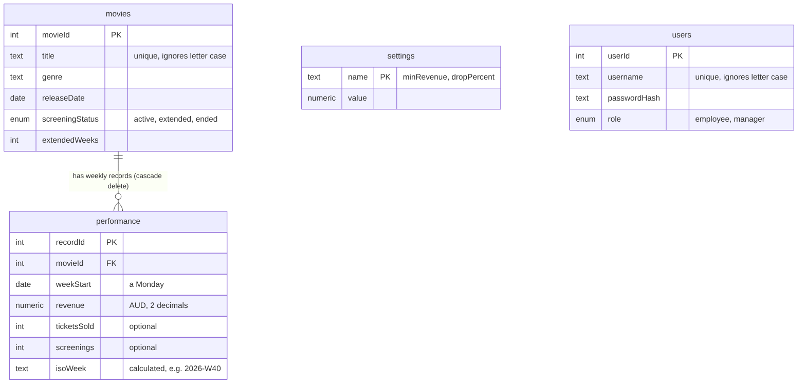

# Database design (Rose Budha)

## Tables

- **movies**: one row per movie. Title is unique ignoring letter case. `screeningStatus` is `active`, `extended` or `ended`. `extendedWeeks` counts weeks added.
- **performance**: one row per movie per week. `weekStart` is the Monday date. `revenue` is AUD with at most 2 decimals. `ticketsSold` and `screenings` are optional. `isoWeek` is calculated (for example `2026-W40`). The pair (`movieId`, `weekStart`) is unique. Deleting a movie deletes its rows.
- **settings**: the review thresholds `minRevenue` and `dropPercent`.
- **users**: optional login (not used in contract v1.0.0). Stores a password hash only.

## Views

- **v_weekly_report**: each weekly record with the previous week's revenue (the record seven days earlier), the difference, and the percent change. These are empty when there is no previous week.
- **v_review_flags**: records that fall below `minRevenue` or drop by `dropPercent` or more, excluding ended movies. The reason is `BELOW_MIN_REVENUE` or `SHARP_DROP`.

## Rules in the database

| Rule | How it is enforced |
|---|---|
| One record per movie per week | unique index on (`movieId`, `weekStart`) |
| Week is a Monday | CHECK on ISO day of week |
| Revenue at least 0, at most 2 decimals | CHECK |
| Tickets and screenings not negative | CHECK |
| Title not blank, unique ignoring case | CHECK and unique index on `lower(title)` |
| Movie must exist for a record | foreign key, cascade on delete |
| Screening status is one of three values | database enum |

## Queries

Q1 list movies, Q2 get movie, Q3 add movie, Q3b find movie by name, Q4 record revenue, Q5 correct record, Q6 delete record, Q7 weeks with data, Q8 weekly report, Q9 weekly summary, Q10 revenue trend, Q11 review flags, Q12 extend screening, Q13 end screening, Q14 update movie, Q15 delete movie. They are in `backend/src/rose/repositories/`.
